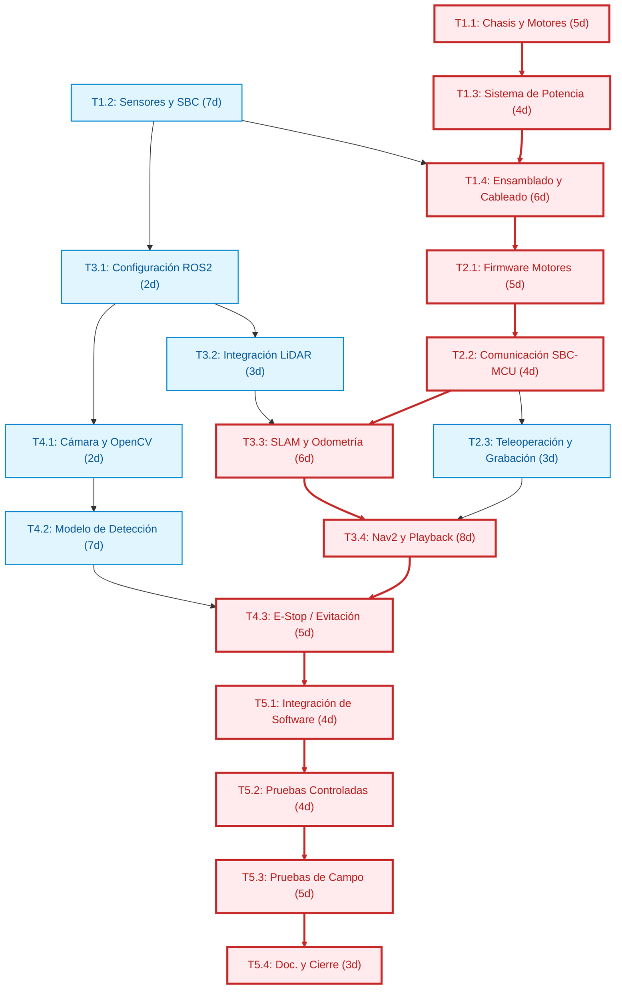
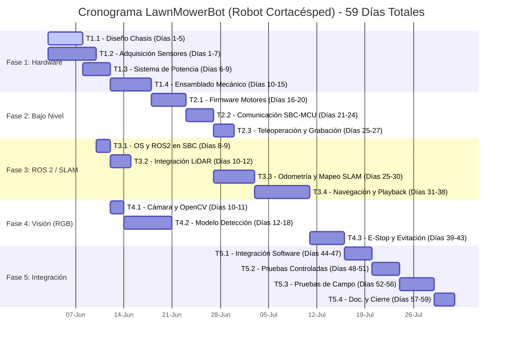

# Gantt, Grafo y Camino Crítico

Este documento contiene las tres piezas clave de la planificación del proyecto: el grafo de dependencias, el diagrama de Gantt y el análisis del camino crítico.

## 1. Tareas del proyecto

| Código | Tarea | Duración | Predecesores |
|---|---|---|---|
| T1.1 | Chasis y Motores | 5 días | - |
| T1.2 | Sensores y SBC | 7 días | - |
| T1.3 | Sistema de Potencia | 4 días | T1.1 |
| T1.4 | Ensamblado y Cableado | 6 días | T1.2, T1.3 |
| T2.1 | Firmware Motores | 5 días | T1.4 |
| T2.2 | Comunicación SBC-MCU | 4 días | T2.1 |
| T2.3 | Teleoperación y Grabación | 3 días | T2.2 |
| T3.1 | Configuración ROS2 | 2 días | T1.2 |
| T3.2 | Integración LiDAR | 3 días | T3.1 |
| T3.3 | SLAM y Odometría | 6 días | T3.2, T2.2 |
| T3.4 | Nav2 y Playback | 8 días | T3.3, T2.3 |
| T4.1 | Cámara y OpenCV | 2 días | T3.1 |
| T4.2 | Modelo de Detección | 7 días | T4.1 |
| T4.3 | E-Stop / Evitación | 5 días | T4.2, T3.4 |
| T5.1 | Integración de Software | 4 días | T4.3 |
| T5.2 | Pruebas Controladas | 4 días | T5.1 |
| T5.3 | Pruebas de Campo | 5 días | T5.2 |
| T5.4 | Documentación y Cierre | 3 días | T5.3 |

## 2. Grafo de dependencias

## 3. Diagrama de Gantt

## 4. Análisis del camino crítico

El camino crítico es la secuencia de tareas que determina la duración mínima del proyecto. Si alguna de estas tareas se retrasa, el proyecto se atrasará.

### Tareas en el camino crítico

- T1.1: Chasis y Motores
- T1.3: Sistema de Potencia
- T1.4: Ensamblado y Cableado
- T2.1: Firmware Motores
- T2.2: Comunicación SBC-MCU
- T3.3: SLAM y Odometría
- T3.4: Nav2 y Playback
- T4.3: E-Stop / Evitación
- T5.1: Integración de Software
- T5.2: Pruebas Controladas
- T5.3: Pruebas de Campo
- T5.4: Documentación y Cierre

### Tabla de tiempos y holguras

| Código | Tarea | Duración | Holgura | Crítico |
|---|---|---|---|---|
| T1.1 | Chasis y Motores | 5 | 0 | Sí |
| T1.2 | Sensores y SBC | 7 | 2 | No |
| T1.3 | Sistema de Potencia | 4 | 0 | Sí |
| T1.4 | Ensamblado y Cableado | 6 | 0 | Sí |
| T2.1 | Firmware Motores | 5 | 0 | Sí |
| T2.2 | Comunicación SBC-MCU | 4 | 0 | Sí |
| T2.3 | Teleoperación y Grabación | 3 | 3 | No |
| T3.1 | Configuración ROS2 | 2 | 12 | No |
| T3.2 | Integración LiDAR | 3 | 12 | No |
| T3.3 | SLAM y Odometría | 6 | 0 | Sí |
| T3.4 | Nav2 y Playback | 8 | 0 | Sí |
| T4.1 | Cámara y OpenCV | 2 | 20 | No |
| T4.2 | Modelo Detección | 7 | 20 | No |
| T4.3 | E-Stop / Evitación | 5 | 0 | Sí |
| T5.1 | Integración de Software | 4 | 0 | Sí |
| T5.2 | Pruebas Controladas | 4 | 0 | Sí |
| T5.3 | Pruebas de Campo | 5 | 0 | Sí |
| T5.4 | Documentación y Cierre | 3 | 0 | Sí |

## 5. Cómo usar esto en tu entrega

- Si necesitas un documento de planificación, copia este archivo completo.
- Si necesitas sólo el Gantt y el grafo, usa las secciones 2 y 3.
- Si necesitas explicar el camino crítico, usa la sección 4.
- Puedes pegar esto directamente en tu informe o presentación.
