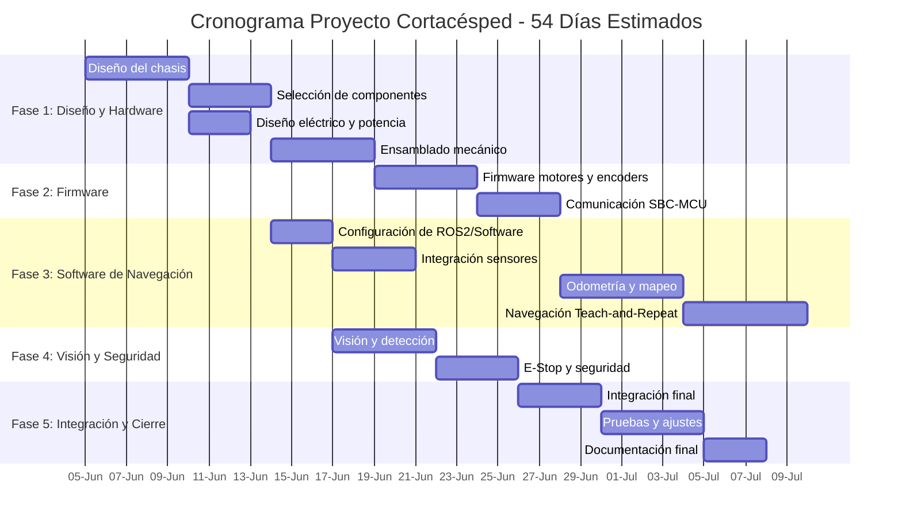

# Planificación del Proyecto: Cortadora de Pasto Semi-Autónoma

Este documento organiza el trabajo del proyecto en tareas, dependencias y cronograma.

## Estructura del trabajo (WBS)

| Código | Tarea | Duración | Predecesores |
|---|---|---|---|
| T1.1 | Diseño del chasis | 5 días | - |
| T1.2 | Selección de componentes | 4 días | T1.1 |
| T1.3 | Diseño eléctrico y de potencia | 3 días | T1.1 |
| T1.4 | Ensamblado mecánico | 5 días | T1.2, T1.3 |
| T2.1 | Firmware motores y encoders | 5 días | T1.4 |
| T2.2 | Comunicación SBC-MCU | 4 días | T2.1 |
| T3.1 | Configuración de ROS2 / software | 3 días | T1.2 |
| T3.2 | Integración de sensores LiDAR/cámara | 4 días | T3.1 |
| T3.3 | Odometría y mapeo | 6 días | T2.2, T3.2 |
| T3.4 | Navegación Teach-and-Repeat | 6 días | T3.3 |
| T4.1 | Visión y detección de obstáculos | 5 días | T3.1 |
| T4.2 | E-Stop y seguridad | 4 días | T4.1, T3.4 |
| T5.1 | Integración final | 4 días | T4.2 |
| T5.2 | Pruebas y ajustes | 5 días | T5.1 |
| T5.3 | Documentación final | 3 días | T5.2 |

## Diagrama de Gantt

## Camino crítico

Las tareas críticas son aquellas que no tienen holgura y determinan la duración mínima del proyecto.

- T1.1 Diseño del chasis
- T1.2 Selección de componentes
- T1.4 Ensamblado mecánico
- T2.1 Firmware motores y encoders
- T2.2 Comunicación SBC-MCU
- T3.3 Odometría y mapeo
- T3.4 Navegación Teach-and-Repeat
- T4.2 E-Stop y seguridad
- T5.1 Integración final
- T5.2 Pruebas y ajustes
- T5.3 Documentación final

## Riesgos y recomendaciones

1. Hardware: si no tienes LiDAR, usa un sensor ultrasonido o define el proyecto como propuesta técnica.
2. Software: si no puedes instalar ROS2, documenta la arquitectura y ofrece pseudocódigo.
3. Tiempo: usa este plan para priorizar primero el chasis, la comunicación y la navegación.

## Qué hacer ahora

- Si tu entrega es escrita, usa estos dos archivos como base.
- Si necesitas un informe más corto, dime y te preparo un resumen ejecutivo.
- Si quieres, también puedo ayudarte a crear pseudocódigo para la parte de control o un diagrama de nodos.
